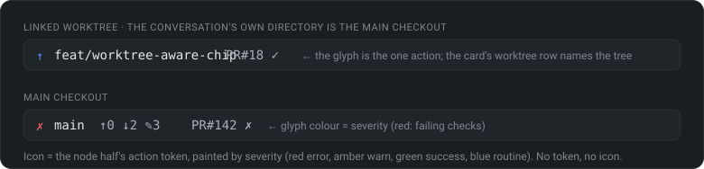
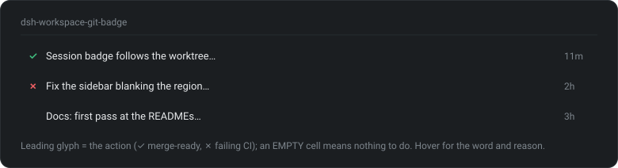

# dsh-git-badge

Git status badges for [DeepSeek Harness](https://github.com/deepseek-ai/deepseek-harness)

[](https://github.com/Kevin-McIsaac/dsh-workspace-git-badge/actions/workflows/test.yml)

## Why 

Most agent workflow failures happen quietly: branches drift, uncommitted files are left behind, 
and approved PRs or failed builds sit unnoticed. This plugin brings repository 
awareness directly into your workflow:

1. **At-a-glance session status**: branch, file counts and PR/CI state on the input box. When the session is working in a linked [`git worktree`](#Worktrees), the badge follows that tree rather than the main checkout.



2. **Actionable session overview**: pinpoints the session requiring attention. The session row status icon is extended to show what git actions are needed, e.g., push, merge. The row's hover card lists this icon, the action and the reason (`↑ push — no upstream configured`).



Both are updated within seconds of any commit, checkout, stage or file
edit — including inside a linked  [worktree](#Worktrees) for safe isolation of parallel dhs working session.

## Install

Use the plugin market place or install manually:

```bash
dsh plugin --profile web add dsh-git-badge     # marketplace Install does this step
```

Then **restart the web process** and refresh the browser. That is the whole
install: every surface rides an upstream slot, so there is nothing to patch and
no second step.


## Sidebar technical details

The status icon renders using the upstream 
`sidebar.session.row.leading` seat — a 16px cell in the row's leading cluster,
rendered only while the session is idle. The hover-card provenance line rides
upstream's own `sidebar.session.row.hover` seat as well. 


## Testing

See [`TESTING.md`](TESTING.md) — clean-profile boot (customer simulation) and the
gotchas list. `cd dsh-git-badge && npm test`
runs the whole suite (parser, real temp repositories, resolution, SSE, the
watcher, every `gh` degradation path and the rendered surfaces) with no DSH, no
network and no restart.

# Worktrees

A worktree isolates each session to ensure it does not step on another 
sessions work, e.g., change or delete the branch, modify the same file.

### The challenge
A DSH session remembers the directory it was created in and that
value can't be changed. After moving a session to a worktree there is no native method 
for the status badge to identify which worktree the session maps to. This
means the status badge reports the wrong branch, the wrong counts, 
the wrong pull request. 

### The solution
When we switch to a worktree, we create an entry in the register, that
is stored on disk. To ensure this is done properly we use the included
worktree skill

## Requirements

- Node.js ≥ 20, `git` on PATH
- DSH with the `web` profile (any install)
- `gh` on PATH, authenticated, for the PR/CI token and the row's `merge`/`review`
  actions — otherwise those are silently absent and everything else still works

## License

[MIT](LICENSE)
